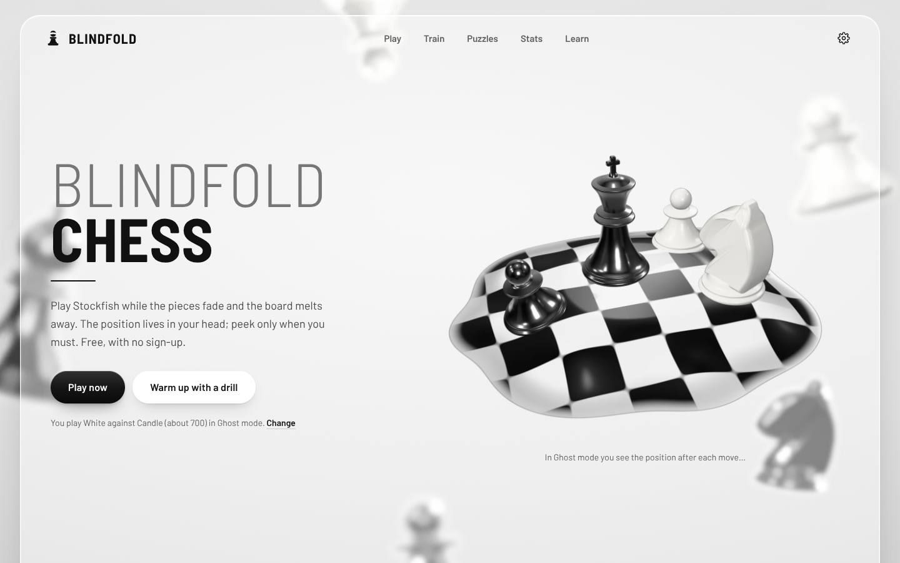
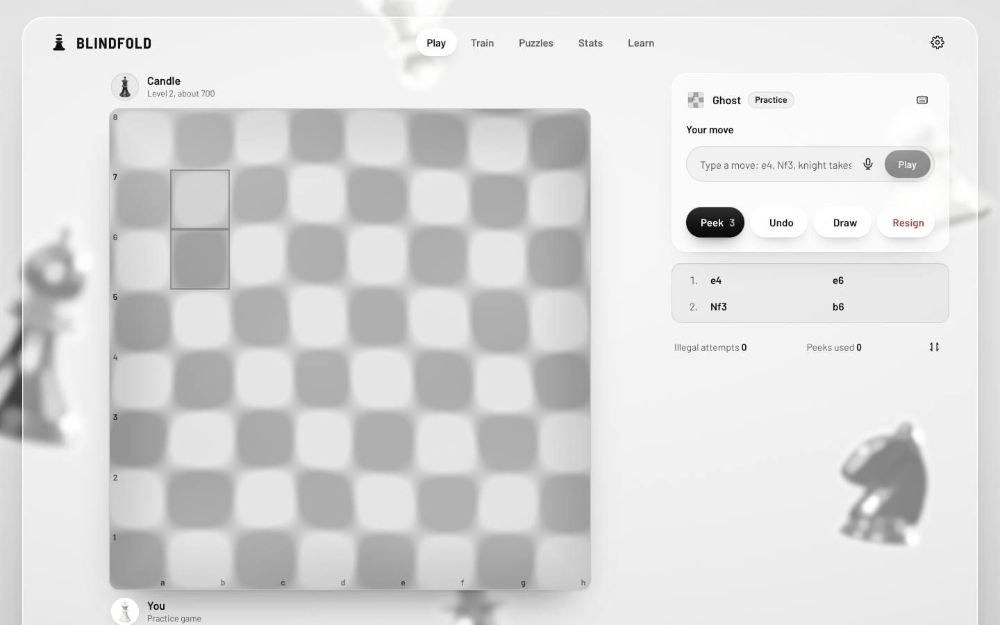
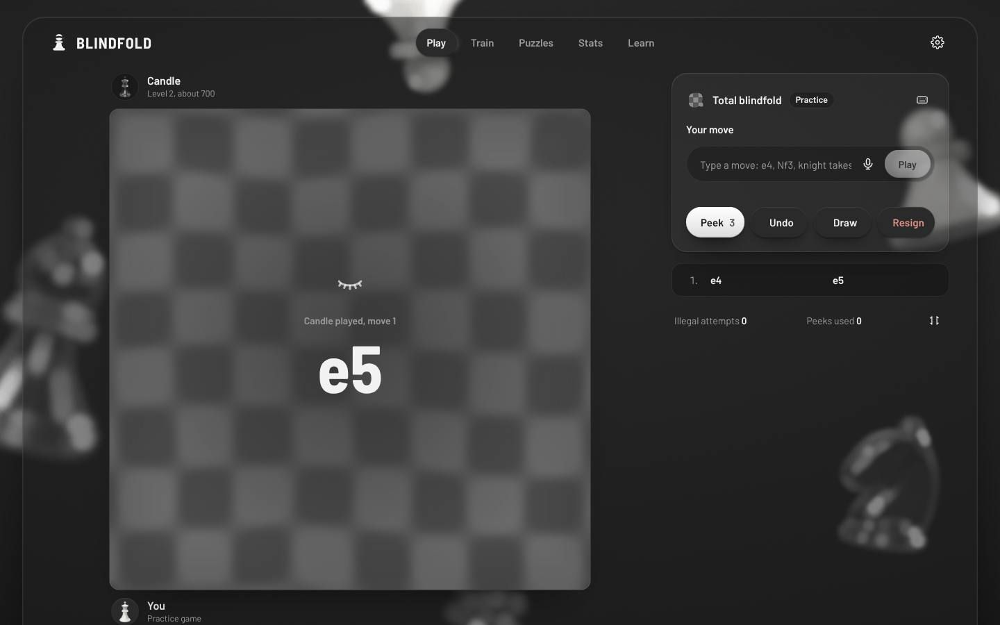
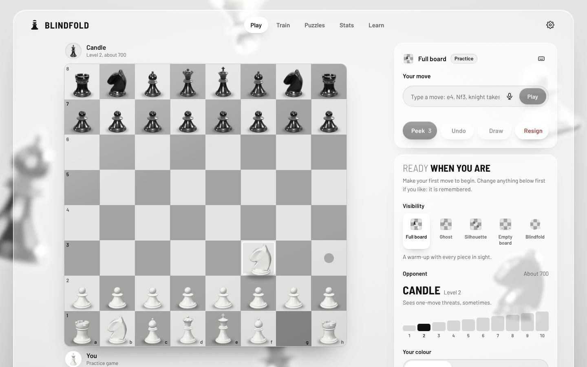
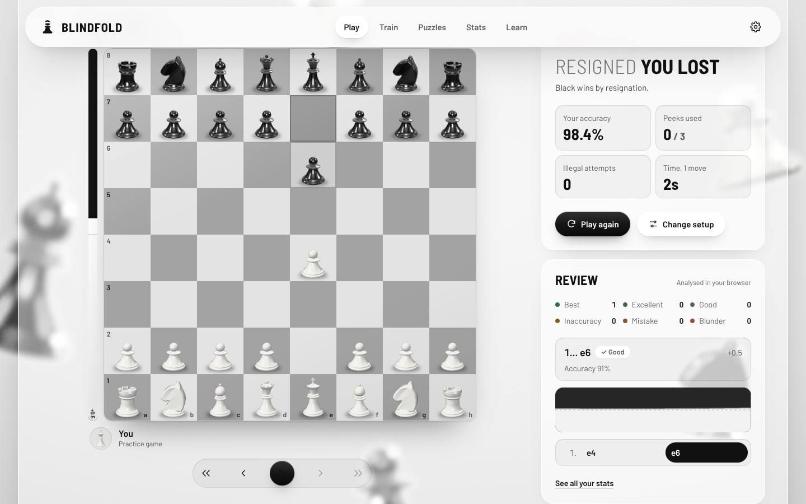
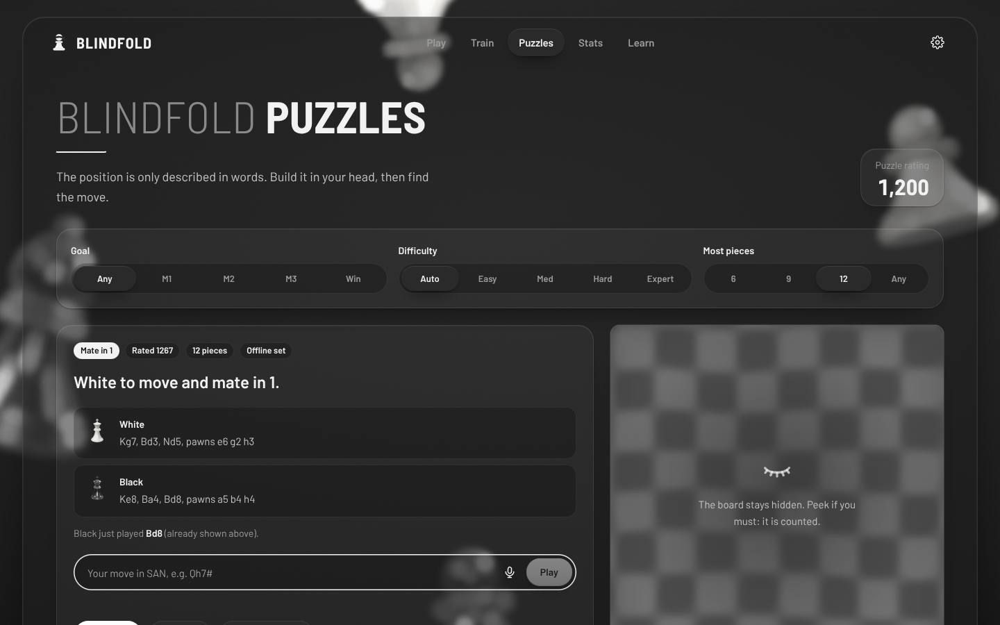
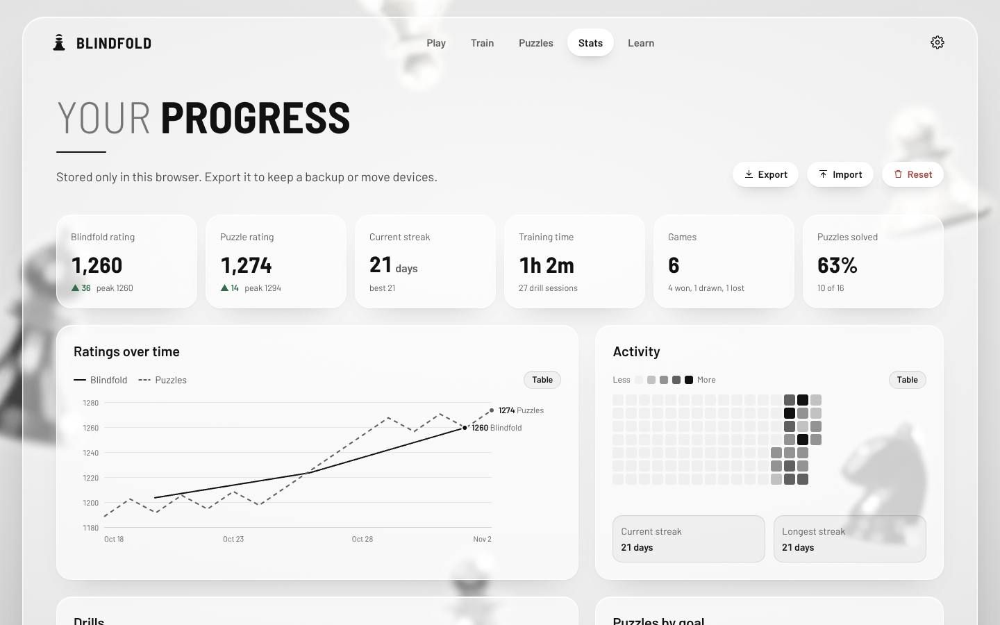
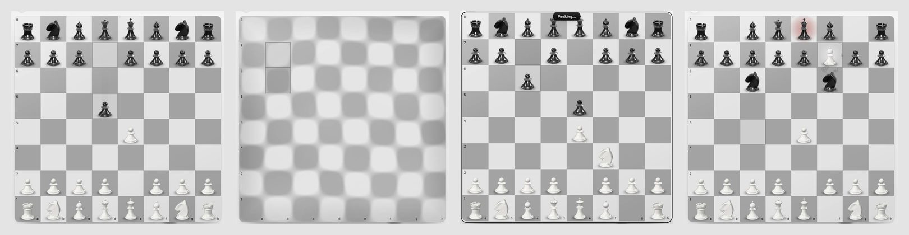
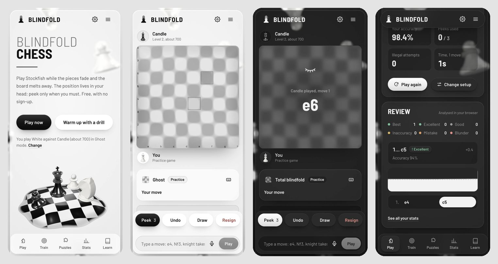

# Blindfold — learn to play chess without seeing the board

**Blindfold** is a free, open-source trainer for blindfold chess. Play Stockfish while the pieces fade and
the board melts away, or with no board at all; sharpen your board vision with short drills; solve real puzzles
given only as text; and watch your progress — all in the browser, with no account. One click from the home page
and a game is waiting for your first move.



<p align="center">
  
  
</p>

## What you can do

**Play vs Stockfish, blindfolded**
- Stockfish 19 (WebAssembly) runs in a Web Worker in your browser — no server needed.
- 10 levels, from *Ember* (~400) to full-strength *Supernova*. Choose your colour and an optional clock.
- Five visibility modes: **Full board** (warm-up) → **Ghost** (pieces fade after each move) →
  **Silhouette** (you see occupied squares, not pieces) → **Empty board** (coordinates only, the last
  move flashes) → **Total blindfold** (no board at all). When the pieces go, the board melts; a peek
  makes it solid again.
- **Play now** starts a game straight away with your remembered setup (by default White, against
  *Candle*, in Ghost mode); change anything before your first move. A game in progress is one click away
  (**Continue game**).
- Enter moves by **typing** (SAN, UCI or words, with live validation and autocomplete), **clicking**
  squares on the hidden board, or **speaking** ("knight f three", "castle long", "bishop takes c6").
  Moves can be read aloud.
- Limited **peeks** lift the blindfold for a few seconds. Peeks and illegal attempts are counted.
- **Practice** mode (takebacks, hints) and **Rated** mode (your local blindfold rating).
- Every rule: castling, en passant, promotion, check/mate, stalemate, threefold, 50-move rule,
  insufficient material, resignation, draw offers and flag fall. Refreshing restores the game.
- Game over, in place: the board is revealed, your accuracy, peeks, illegal attempts and time appear
  beside it, and the engine review (eval bar, eval graph, move classifications, replay) loads onto the same
  board. **Play again** keeps your settings.

**Train your mind's eye** — six drills, each with levels, a timed mode, instant feedback and an end screen
(one tap starts a drill at the level you last used):
square colours · coordinates (both sides, no labels) · knight routes · diagonals & lines ·
"where's the piece?" (follow a game from text or audio) · memory (rebuild a position).

**Blindfold puzzles** — 4,000 Lichess puzzles (CC0) filtered for blindfold play (few pieces, short
solutions): mate in 1/2/3 or the winning move, with the position given as text. Answer in SAN.

**Stats** — ratings over time, an activity heatmap and streaks, per-drill accuracy, puzzle results by
goal and a game history with replays. Stored locally in IndexedDB; export/import as JSON.

<p align="center">
  
  
</p>
<p align="center">
  
  
</p>





More in [`docs/screenshots/`](docs/screenshots/), and every page before and after the redesign, in light and
dark, in [`docs/design/`](docs/design/).

## Quick start

Requirements: **Node.js 20.9+** and, for the optional API, **[uv](https://docs.astral.sh/uv/)**.
Stockfish for the API is optional too (`apt install stockfish` / `brew install stockfish`) — without
it, game analysis simply runs in the browser.

```bash
make dev
```

That installs whatever is missing and starts both apps:

- web app → http://localhost:3000
- API → http://localhost:8000/api/docs

No `uv`? `make dev` still starts the web app in offline mode (built-in puzzles, in-browser drills
and analysis). Prefer containers? `docker compose up --build`.

| Command | What it does |
|---|---|
| `make dev` | install + run API and web app together |
| `make test` | unit tests (Vitest + pytest) |
| `make lint` | ESLint + `tsc`, Ruff + mypy |
| `make e2e` | Playwright end-to-end tests against a production build |
| `make build` | production build of the web app |
| `make puzzles` | rebuild the puzzle set from the Lichess database |

## Architecture

```
┌──────────────────────────── browser ─────────────────────────────┐
│ Next.js 16 (App Router, static pages) · React 19 · Tailwind 4    │
│                                                                  │
│  Board (Motion springs, drag, WebGL melt)   chess.js rules       │
│  Pieces: 3D-rendered WebP sprites · live three.js hero (lazy)    │
│  Stockfish 19 WASM ── Web Worker ── UCI client (levels, analysis)│
│  Drills: seeded generators          Speech: Web Speech API       │
│  Progress: IndexedDB (idb) ─ export/import JSON                  │
│  Fallbacks: /data/puzzles.json (1,200 puzzles), local generators │
└──────────────┬───────────────────────────────────────────────────┘
               │ NEXT_PUBLIC_API_URL (optional, may be asleep)
┌──────────────▼───────────── FastAPI (Python 3.12, uv) ───────────┐
│ /api/health  /api/puzzles[...]  /api/drills/{sequence,           │
│ knight-route,position}  /api/analysis (python-chess + Stockfish) │
│ 4,000 puzzles from the Lichess CC0 database (backend/scripts/)   │
└──────────────────────────────────────────────────────────────────┘
```

- **The backend is optional.** The site pings `/api/health`; while the API is asleep or missing, puzzles
  come from the bundled JSON, drills are generated locally from the same seeds, and analysis runs in the
  browser. A small pill in the footer shows which mode you're in.
- **The engine** is the single-threaded *lite* build of Stockfish 19, so no cross-origin-isolation
  headers are needed and it runs on any static host. It is copied from the `stockfish` npm package at
  build time and loaded only when a game or analysis needs it.
- **Animation** uses Motion springs on transforms and opacity only. Pieces keep a stable identity across
  positions, so they glide rather than teleport — including castling (king, then rook), en passant and
  promotion. Reduced motion is respected (OS setting or in-app switch).
- **3D, rendered ahead of time.** The pieces are modelled in code with three.js (`frontend/src/three/`) and
  rendered to WebP sprites, hero frames and depth-of-field backdrop pieces by
  `frontend/scripts/render-3d.mjs`; the results are committed. The board's melt is a small raw-WebGL shader.
  Only the home page hero loads Three.js live, on capable desktops, once the page is idle.
- **Design** — the "Studio" look (light and dark themes, Barlow, glass, monochrome): see
  [`docs/design/REDESIGN_REPORT.md`](docs/design/REDESIGN_REPORT.md).

```
frontend/   Next.js app (src/app routes, src/components, src/lib: chess, engine, drills, storage…)
backend/    FastAPI app (app/), puzzle pipeline (scripts/), tests/, Dockerfile
docs/       screenshots; design/ holds the redesign brief, plan, decisions, report and before/after shots
```

## Tests

- **Unit** — 133 Vitest tests (move/SAN/UCI parsing, voice normalisation, drill generators, accuracy
  formulas, ratings and streaks, IndexedDB storage, piece tracking, the game store's clock and move
  validation, the move input in jsdom, the engine client against a fake worker, settings migration and the
  game setup defaults) and 267 pytest tests (every endpoint, the puzzle pipeline, the pure-Python mate
  search, analysis formulas).
- **End-to-end** — Playwright plays a full game against Stockfish in every visibility mode (typed and
  clicked moves), answers every drill correctly, solves puzzles, and checks the play-first flow (home to a
  live game in one click, game over in place, Play again keeping the setup, continuing a saved game),
  one-tap drills, settings persistence and themes, refresh restore, import/export and replays, the
  backend-down fallback, the backend-up path, touch drag and the move bar on a phone, and that no page
  scrolls sideways at phone width.
- **CI** — GitHub Actions runs lint, type checks, unit tests and the production build for both apps, the
  Playwright suite against both servers, and a Docker build + smoke test of the API.

## Deploying

Everything fits free tiers: the web app on **Vercel Hobby**, the API on **Render** (free) or a
**Hugging Face Docker Space**. Step by step in [DEPLOY.md](DEPLOY.md).

## Credits & licence

GPL-3.0-or-later (it ships Stockfish). Puzzles from the [Lichess puzzle database](https://database.lichess.org/#puzzles)
(CC0). Type is Barlow (SIL OFL 1.1). The "Classic" pieces are Colin M.L. Burnett's *cburnett* set; the default
"Gloss" pieces (modelled and rendered in code for this project), the "Lumen" set, icons, sounds (synthesised
live) and design are original. Full list in [CREDITS.md](CREDITS.md).

Design notes and every judgement call made while building: [DECISIONS.md](DECISIONS.md) ·
build plan: [PLAN.md](PLAN.md) · redesign: [docs/design/](docs/design/).
