# Redesign report: "Studio"

The whole frontend has been redesigned against [`REDESIGN_BRIEF.md`](REDESIGN_BRIEF.md) and the
[style reference](style-reference.jpeg): a monochrome photo studio with glossy porcelain-and-lacquer pieces, a
frosted glass stage and a chessboard that melts when the pieces disappear. The flow is play-first: one click from
the home page to a game that is waiting for your first move. The backend is untouched, and every feature from
[`MORNING_REPORT.md`](../../MORNING_REPORT.md) is still there.

- Plan, tokens and checklist: [`REDESIGN_PLAN.md`](REDESIGN_PLAN.md)
- Every judgement call, including the three polish passes: [`DECISIONS.md`](DECISIONS.md)
- Screenshots: [`before/`](before/) and [`after/`](after/), every page at 1440 px and 390 px in light and dark,
  plus the key states (melt, peek, drag, check, game over, review, every mode, drills, stats, phone keyboard)

## Before and after

| | Before | After |
|---|---|---|
| Home | 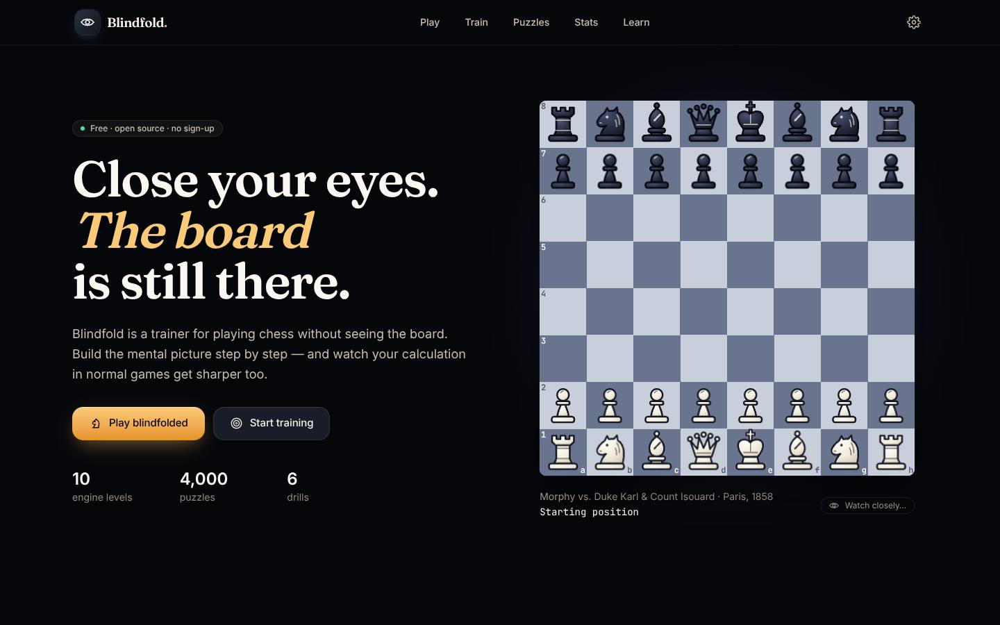 | 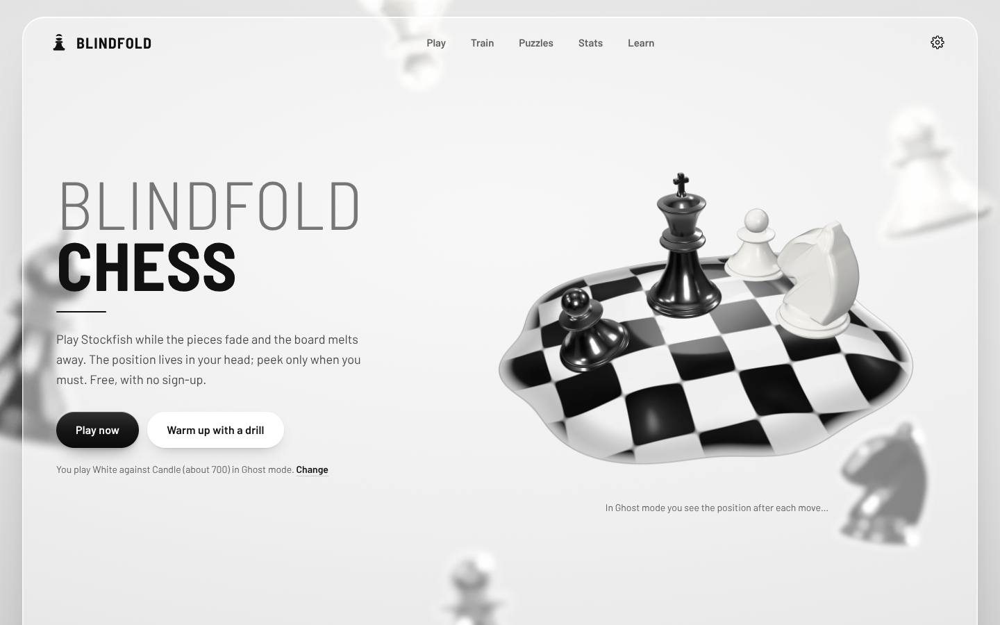 |
| Home, dark |  | 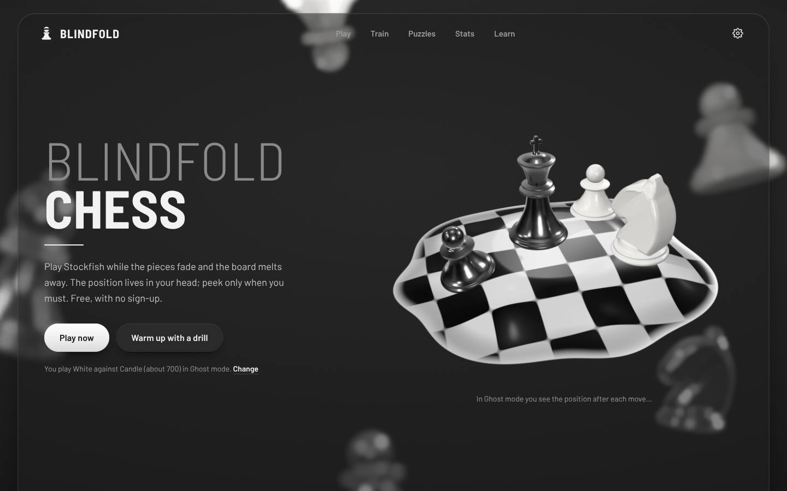 |
| Play | 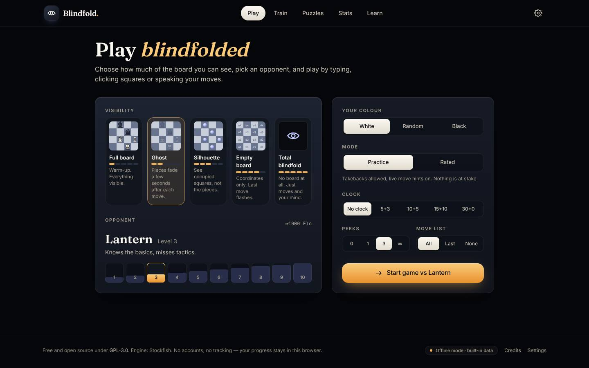 | 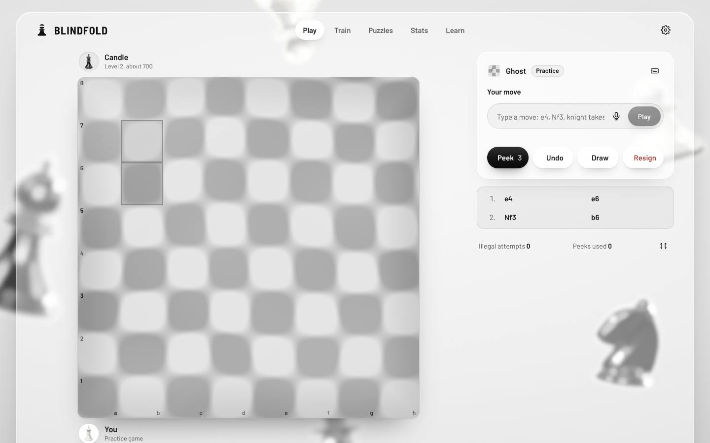 |
| A game | 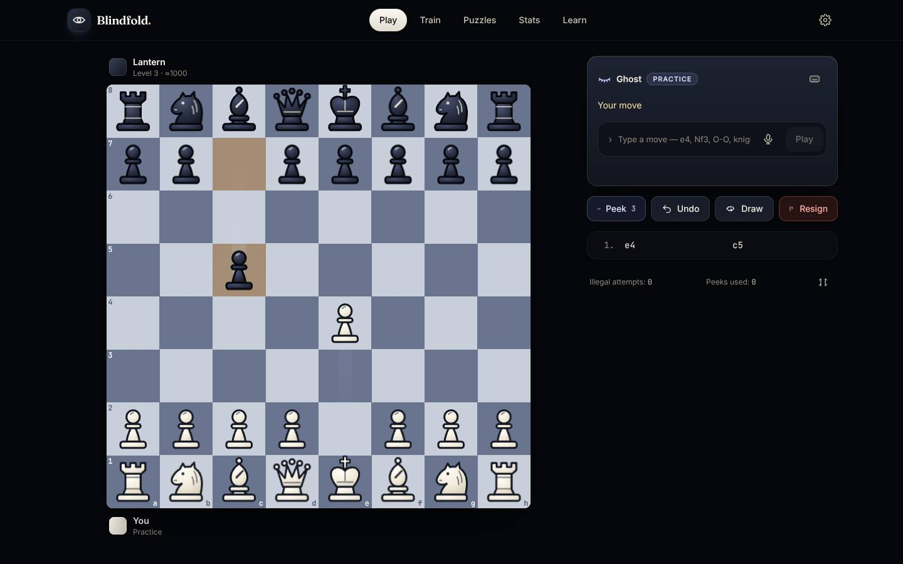 | 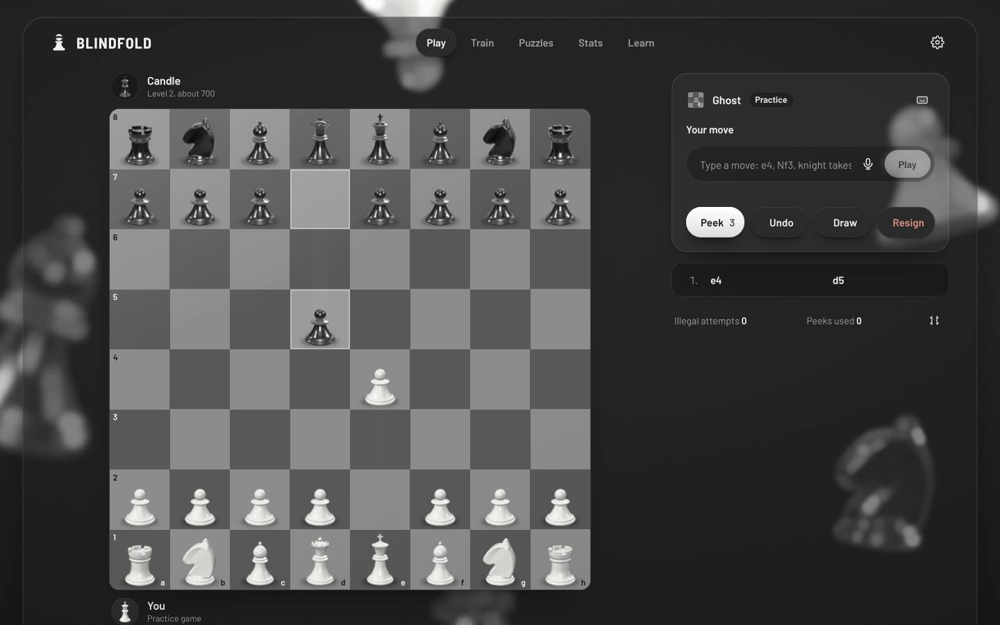 |
| Train | 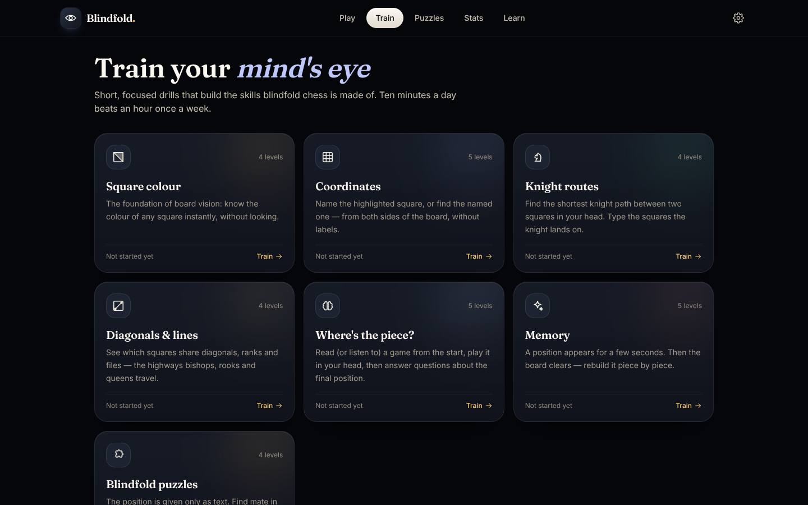 | 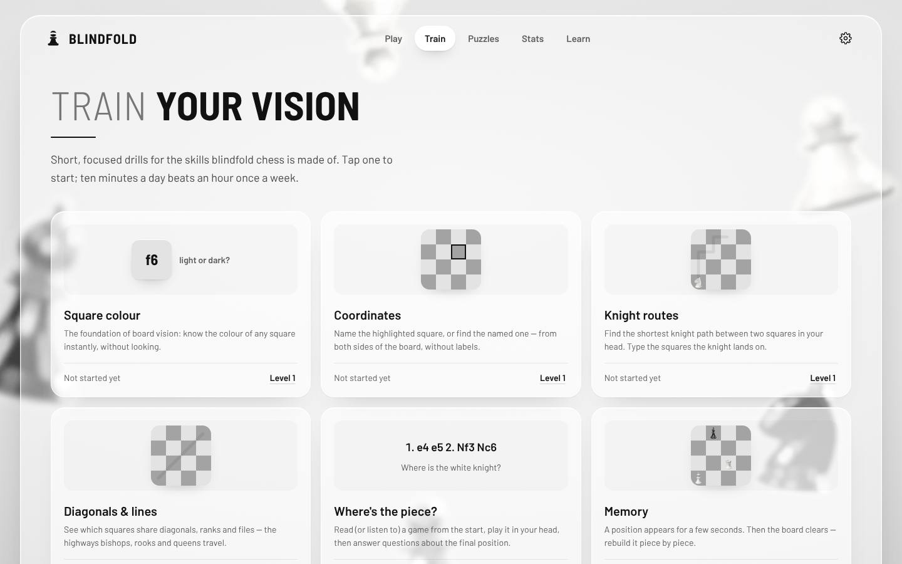 |
| Puzzles | 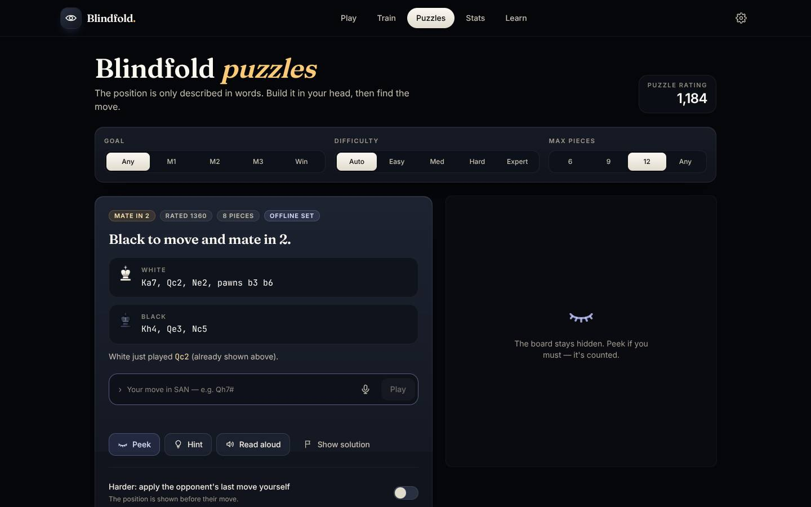 | 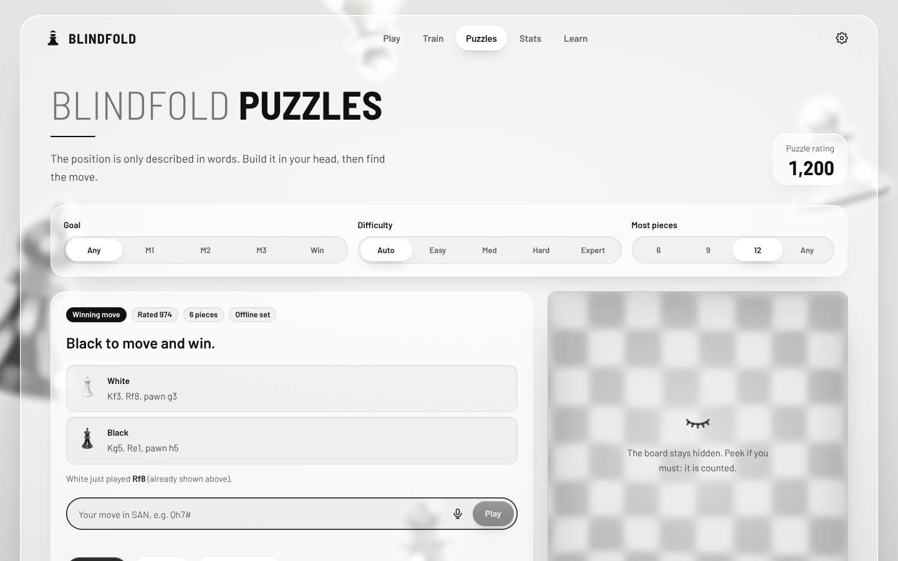 |
| Stats | 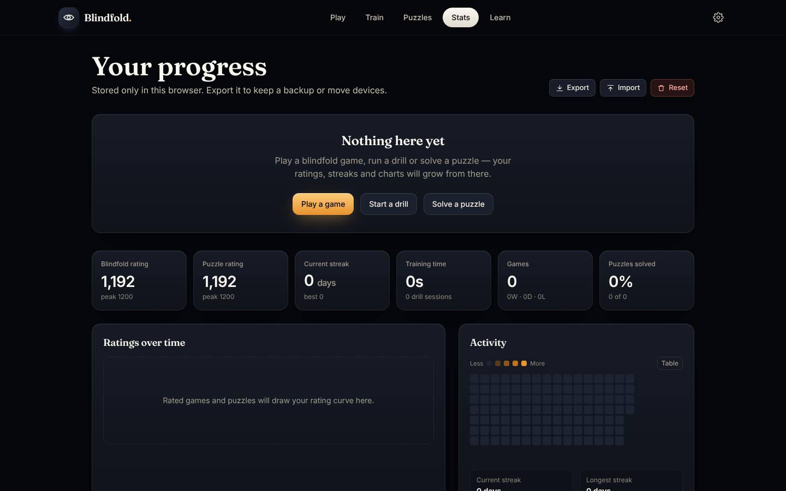 | 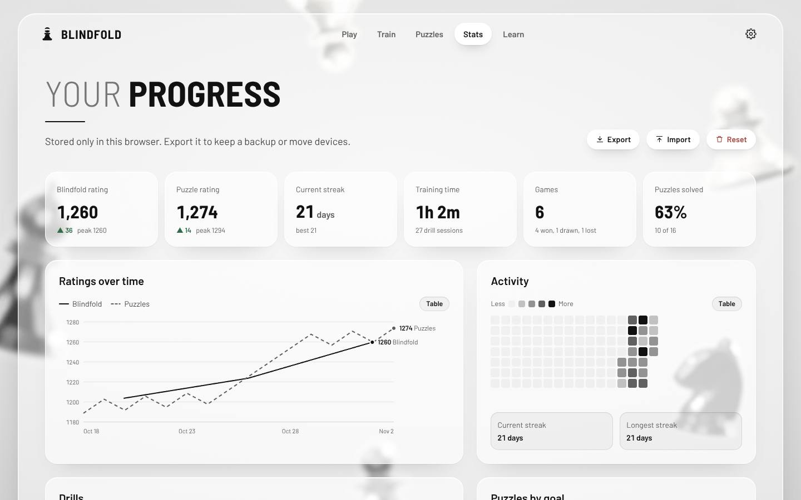 |
| Phone | 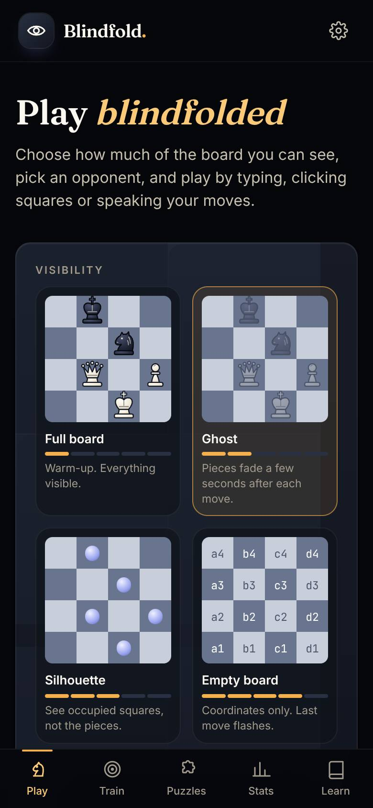 | 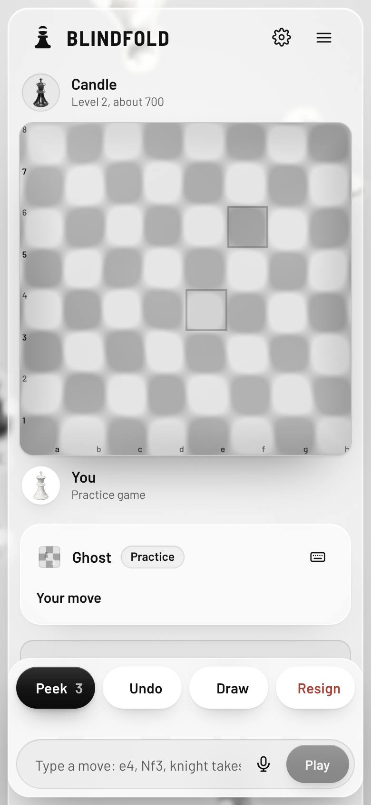 |

The old interface was dark only, so its "light" captures are identical to the dark ones.

## What changed

**Look.** A new design system (tokens in `frontend/src/app/globals.css`): a light gray studio with a soft
vignette, a frosted glass stage, white and black pill buttons, uppercase headlines that set a thin gray word
against a bold black one over a short rule, and Barlow / Barlow Semi Condensed, self-hosted. Color is kept for
meaning only: green for right, red for wrong, check and loss, amber for inaccuracies and mistakes. Every page has a
light and a dark theme (System / Light / Dark in Settings, applied before the first paint).

**3D, at no cost.** All pieces are modelled in code (`frontend/src/three/pieces.ts`): lathed pawn, rook, bishop,
queen and king and an extruded, sculpted knight, in clearcoated porcelain and black lacquer, lit with three.js's
`RoomEnvironment`. `frontend/scripts/render-3d.mjs` renders them to 256 px WebP sprites for the board (light and
dark lighting), renders the melting hero board, and renders the out-of-focus pieces behind the stage with real
depth of field. On capable desktops the home page swaps the hero frames for the live React Three Fiber scene once
the page is idle; everyone else sees the pre-rendered frames. The playable board never waits for Three.js.

**The melting board.** When the pieces disappear (Ghost after its delay, Silhouette, Empty board, the puzzle
board, Total blindfold) the squares turn to liquid: a small WebGL shader with a slow flow, a ripple from the last
move and a sheen, stronger or weaker by mode. A peek solidifies it in about a quarter of a second. Reduced motion
gets a still frame; no WebGL gets a softened CSS board.

**Play-first flow.**

1. Home → **Play now** (or a mode card) → `/play`, where a game against Candle (level 2), as White, in Ghost mode,
   is already waiting. The first move starts it. The setup is remembered, and can be changed from the home page
   ("Change") or beside the board before the first move.
2. A game in progress turns the home button into **Continue game**, with "Move N of your Ghost game against
   Candle" under it. A refresh restores the game too.
3. The game ends on the same page: the board reveals, the result and your numbers appear beside it, the engine
   review loads onto the same board (eval bar, graph, classifications, replay controls), and **Play again** starts
   a new game with the same settings.
4. On a phone the board is full width, the move box and the game buttons float in a bar that rides above the
   keyboard, and the dock gives way to it during a game.
5. Train: one tap on a drill starts it at the level you last used. Puzzles: the page opens on a puzzle.

| Task | Before | After |
|---|---|---|
| Home → a game waiting for your first move | 2 clicks | 1 click |
| Continue a game in progress from home | 1 click ("Play") | 1 click ("Continue game") |
| Play again with the same settings | 1 click | 1 click, with the review on the same page |
| Start a game in another mode | 3 clicks | 1 click (a mode card) |
| Start a drill from Train | 2 clicks | 1 tap |

**Every page** was rebuilt on the new system: Train and the six drills (intro with a live preview, countdown,
running, feedback, results), Puzzles (the hidden board is a frosted melt), Stats (monochrome charts with dashed
second series, heatmap, tables, replays), Learn, Settings (theme, board themes, piece sets: Gloss by default, Lumen
and Classic still available), Credits and the 404 page. Old links (`/play`, `/train/*`, …) all still work, and
settings saved by the old version are migrated (old board themes map to the new ones).

**Kept on purpose.** All the animations (drag lift and magnetic snap, spring moves, capture shatter, castling in
two beats, check glow, promotion picker, arrows, mist, trails, the mated king toppling, confetti, now in
monochrome) and all the synthesized sounds.

## What to try first

1. Open `/` and press **Play now**. Type `e4` (or drag the e-pawn). Wait three seconds: the pieces fade and the
   board melts. Press **Peek** (or `P`) to see it again for a moment.
2. On a desktop with a GPU, stay on the home page for a couple of seconds: the hero becomes the live 3D scene
   running the same Ghost demo. Move the pointer and scroll to see the out-of-focus pieces drift.
3. Resign (or play on). The result appears beside the board and the review loads onto it: step through the moves
   with the arrow keys or the replay bar. Press **Play again**.
4. Go back home: the button now says **Continue game** if a game is in progress. Try the **Total blindfold** mode
   card: no board at all, only the last move in large type over the melted pool.
5. Switch Settings → Appearance to **Dark** (or follow the system), and try another board theme.
6. Train: tap **Knight routes**. It starts at once; on a phone it brings its own square keypad.
7. Puzzles: read the position in words and answer in SAN.
8. On a phone: the board fills the width, and the move bar sits right above the keyboard.

## How it was checked

- **Unit:** 133 Vitest tests (16 files; new ones for settings migration, the game setup defaults and the toast
  queue) and 253 pytest tests (14 skipped without a local Stockfish binary).
- **End to end:** 54 Playwright tests against the production build with the backend running, as CI does, including
  new flow tests: home to a live game in one click with the default setup, the first move on `/play`, a mode card
  starting that mode, game over in place with the review, Play again keeping the setup, continuing a saved game
  from home, the Change dialog, one-tap drills and remembered drill levels, and the phone move bar.
- **`make test`, `make lint`, `next build`:** green.
- **Accessibility:** axe-core (WCAG 2.0–2.2 A/AA plus best practices) reports nothing on any page or on the main
  states (peek, resign dialog, game over and review, a running drill, the setup dialog), in both themes, at 1440 and
  390 px.
- **Lighthouse, mobile, `/`:** performance 87, accessibility 100, best practices 96, SEO 100.
- **Reduced motion:** no loops, no parallax, no transforms; only opacity fades remain.

## Known issues and limits

- **Performance headroom is small.** Lighthouse's simulated LCP on `/` is about 4 s (the hero frame itself loads in
  about one second; the simulation charges the React, Next.js and Motion runtime evaluated before it to 4× slower
  CPU). The score is 87. The next steps, if needed, are keeping the game store (and with it chess.js and the
  IndexedDB code) off the home page and moving Motion to lazily loaded features; both touch many files, so they
  are left as follow-ups (see DECISIONS).
- **Best practices is 96, not 100,** because Chrome logs a failed request when the optional API is asleep or
  missing: that is the offline mode working.
- **The live 3D hero is desktop-only** (≥ 1024 px, WebGL 2, four or more cores, no reduced motion, no Save-Data).
  Phones and everything else get the pre-rendered frames, which show the same scene.
- **The stage is a translucent fill rather than a live backdrop blur.** A page-sized `backdrop-filter` rendered in
  visible tiles under software compositing and cost a full-page blur per scroll frame on phones; the backdrop pieces
  are already rendered out of focus, so the look is the same. Real blur is kept for the floating header, dock, move
  bar, toasts and dialogs.
- **With the phone keyboard open** the move bar covers the lower half of the board; there is not room for both. In
  the hidden modes, where most typing happens, the board is not needed.
- **Re-rendering the 3D assets** takes a few minutes in software rendering (`node scripts/render-3d.mjs`, against a
  running dev server); the results are committed, so a normal build never renders.
- **`home-full-*.jpg`** in `after/` shows a seam one screen down: the backdrop is fixed to the viewport, and
  full-page captures only paint it once. Real pages do not have it.
- The README screenshots in `docs/screenshots/` were replaced with ones of the new interface; captures of states
  that were not re-shot (the old setup screen, single animation frames) were removed rather than left showing the
  old look.
